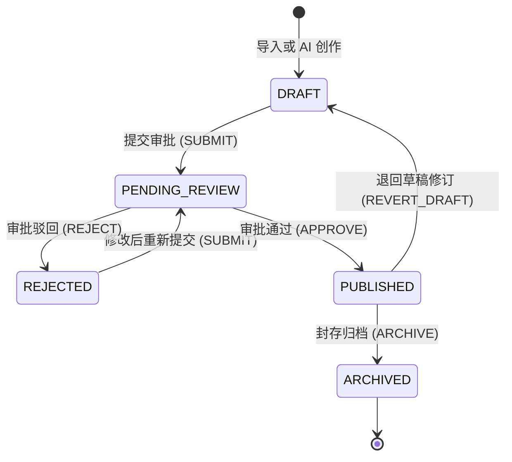

# LexiLoom 知识库管理系统 —— 前端开发对接指南 (Stage 1 & Stage 2)

> **文档状态**：已冻结（对应后端代码交付版本）  
> **覆盖范围**：**Stage 1（用户认证、多空间体系与成员权限）** + **Stage 2（文档生命周期、分类树、版本快照、前端 Diff 渲染、草稿协同与评论树）**  
> **服务基础地址**：`http://localhost:8080` (本地开发)  
> **核心原则**：**前后端算力合理划分** —— 充分利用现代浏览器端算力（如 Markdown 解析渲染、Myers 文本 Diff 对比等），后端仅下发纯净数据契约，释放服务端高并发吞吐能力。

---

## 一、 通信协议与全局交互约定

### 1.1 认证鉴权凭据 (Authorization)
除免登录公开接口（如微信小程序登录接口 `/auth/login`）外，所有 HTTP 请求必须在 Header 中携带 Bearer 令牌：
```http
Authorization: Bearer <accessToken>
```
- 后端令牌过期时间：默认 7200 秒（2 小时）；
- 响应 401 时：前端拦截器应清空本地登录态并引导至登录页。

### 1.2 统一响应与错误格式 (RFC 7807 ProblemDetail)
后端采用现代 Spring 规范化错误结构响应：

```json
{
  "type": "about:blank",
  "title": "Bad Request",
  "status": 400,
  "detail": "当前状态不可提交审批: PENDING_REVIEW",
  "instance": "/documents/100/transition",
  "code": "STATE_MACHINE_ERROR"
}
```
> **前端拦截器建议**：
> 优先使用 `error.response.data.detail || error.response.data.message` 作为 Toast / Message 错误弹窗内容；业务逻辑分支可通过 `code` 字段进行语义判断。

### 1.3 前后端职责分离与算力策略 (重要)
1. **Markdown 渲染**：后端仅持久化并传输 Markdown 原始字符串，所有 AST 解析、HTML 转换、代码高亮（Prism.js / Highlight.js）、LaTeX 公式（KaTeX）与 Mermaid 图表绘制**完全由前端完成**。
2. **版本 Diff 比对**：后端版本比对接口 `/compare` **仅下发新旧版本原文**（纯文本），行级差异运算（Myers Diff）、新增行绿标/删除行红标渲染、并排(Side-by-Side)与内联(Unified)视图切换**完全由前端 Diff 组件计算**。
3. **草稿自动防抖上报**：前端在用户输入时**防抖（Debounce）3~5 秒**调用草稿暂存接口，切勿随按键每次触发。

---

## 二、 阶段一：用户认证与团队空间模块 (`module-auth`)

### 2.1 业务描述
- **多空间体系 (Workspace)**：LexiLoom 采用多租户空间模型。每个用户可属于多个空间，每个空间拥有独立的文档树、分类及成员体系。
- **空间成员 RBAC 角色等级**：
  | 角色代码 | 枚举名称 | 等级权重 | 权限说明 |
  |:---|:---|:---|:---|
  | `OWNER` | 空间所有者 | 100 | 创建者，拥有空间解散、转让、配额调整的全部终极权限 |
  | `ADMIN` | 空间管理员 | 50 | 负责空间日常管理：添加/移除成员、审批文档、维护分类树 |
  | `MEMBER` | 协作成​​员 | 20 | 核心写作者：新建/修改文档、暂存草稿、发起审阅流、评论 |
  | `GUEST` | 访客/只读 | 10 | 外部合作者或只读人员：仅允许查阅受限范围的公开/内部文档 |

---

### 2.2 接口详细规范

#### 1. 微信小程序登录
- **请求方式**：`POST /auth/login`
- **请求入参**：
  ```json
  {
    "loginCode": "081abcdef..." // 微信 wx.login 返回的临时凭证 code
  }
  ```
- **响应示例**：
  ```json
  {
    "accessToken": "uuid-token-string"
  }
  ```

#### 2. 更新个人昵称与头像
- **请求方式**：`PUT /user/update/profile`
- **请求入参**：
  ```json
  {
    "nickName": "知识工程师",
    "avatarUrl": "https://oss.example.com/avatar/user1.png"
  }
  ```
- **响应**：`204 No Content`

#### 3. 创建团队空间
- **请求方式**：`POST /workspace`
- **请求入参**：
  ```json
  {
    "name": "架构设计核心知识库",
    "description": "企业架构与规范标准",
    "code": "arch-team",       // 唯一英文代号
    "avatarUrl": "https://...", // 可选
    "visibility": "INTERNAL"    // PUBLIC | INTERNAL | PRIVATE
  }
  ```
- **响应**：`Long`（新创建的工作空间 ID）

#### 4. 获取当前用户加入的所有空间列表
- **请求方式**：`GET /workspace/my`
- **响应示例**：
  ```json
  [
    {
      "id": 1,
      "name": "架构设计核心知识库",
      "description": "企业架构与规范标准",
      "code": "arch-team",
      "avatarUrl": null,
      "ownerId": 1001,
      "maxMembers": 50,
      "status": "NORMAL",      // NORMAL | FROZEN | DISBANDED
      "visibility": "INTERNAL",
      "createTime": "2026-10-01T08:00:00"
    }
  ]
  ```

#### 5. 获取团队空间详情
- **按 ID 查询**：`GET /workspace/{id}`
- **按英文代号查询**：`GET /workspace/code/{code}`
- **响应**：同上 `WorkSpaceResponse` 对象。

#### 6. 空间生命周期操作
- **修改空间资料**：`PUT /workspace/{id}`（参数含 `name`, `description`, `avatarUrl`, `visibility`）
- **转让所有者**：`PUT /workspace/{id}/transfer-owner`（参数：`{ "newOwnerId": 1002 }`）
- **解散空间**：`PUT /workspace/{id}/disband`
- **冻结/解冻**：`PUT /workspace/{id}/freeze` / `PUT /workspace/{id}/activate`

#### 7. 空间成员管理
- **添加成员**：`POST /workspace/{workSpaceId}/members`
  ```json
  {
    "userId": 1005,
    "role": "MEMBER" // OWNER | ADMIN | MEMBER | GUEST
  }
  ```
- **分页查询成员**：`GET /workspace/{workSpaceId}/members/page?page=0&size=20&keyword=张三`
- **修改成员角色**：`PUT /workspace/{workSpaceId}/members/{userId}/role`
  ```json
  {
    "role": "ADMIN"
  }
  ```
- **移除成员**：`DELETE /workspace/{workSpaceId}/members/{userId}`
- **主动退出空间**：`POST /workspace/{workSpaceId}/members/leave`

---

## 三、 阶段二：文档全生命周期管理 (`module-document`)

### 3.1 业务描述

#### 1. 文档生命周期状态机模型
文档从创建到归档遵循严格的有限状态机约束：



- **编辑权限限制**：仅在 `DRAFT` 和 `REJECTED` 状态下允许编辑正文，进入 `PENDING_REVIEW`（审阅中）或 `ARCHIVED`（归档）后文档为**只读加锁状态**。
- **状态流转驱动**：统一由接口 `POST /documents/{id}/transition` 发送事件触发。

#### 2. 文档访问控制权限 (ACL)
- `PUBLIC`：所有登录成员均可查阅；
- `INTERNAL`：仅当前团队空间成员可查阅与协作；
- `PRIVATE`：仅文档作者本人及空间所有者/管理员（OWNER/ADMIN）可见。

---

### 3.2 接口详细规范

> [!IMPORTANT]
> **LexiLoom 不提供"空白新建文档"与"直接在线修改文档正文"功能。** 所有文档必须通过文件导入（`POST /documents/import`）由 DeepDoc 引擎解析进入系统。当前系统**不需要直接在线修改文档功能**，如需修改文档内容，只能在本地修改原始文件本身并进行二次上传更新（`POST /documents/{id}/reupload` 或 `POST /documents/import?documentId={id}`）。

#### 1. 查阅文档详情
- **请求方式**：`GET /documents/{id}`
- **响应示例**：
  ```json
  {
    "id": 100,
    "workSpaceId": 1,
    "categoryId": 10,
    "title": "系统架构设计规范",
    "summary": "本文档规范了微服务拆分与DDD建模标准",
    "content": "# 系统架构设计规范\n\n## 1. 总则...",
    "status": "PUBLISHED",          // DRAFT | PENDING_REVIEW | PUBLISHED | REJECTED | ARCHIVED
    "visibility": "INTERNAL",       // PUBLIC | INTERNAL | PRIVATE
    "sourceType": "IMPORT",          // IMPORT | AI_GENERATED
    "sourceFileId": null,
    "currentVersion": 2,            // 当前版本序号
    "currentVersionTag": "v1.1",    // 当前版本标签
    "coverUrl": null,
    "wordCount": 1280,
    "readCount": 45,
    "likeCount": 12,
    "createBy": 1001,
    "createTime": "2026-10-01T09:00:00",
    "updateTime": "2026-10-01T10:30:00"
  }
  ```

#### 2. 删除文档（软删除）
- **请求方式**：`DELETE /documents/{id}`
- **响应**：`200 OK`

#### 3. 点赞文档
- **请求方式**：`POST /documents/{id}/like`
- **业务规则**：基于 Redis 24 小时去重保护，同一用户对同一篇文档 24 小时内仅能点赞一次；重复点赞将返回 HTTP 400 业务提示。
- **响应**：`200 OK`

#### 4. 动态多条件分页查询文档列表
- **请求方式**：`POST /documents/page`
- **请求体**：
  ```json
  {
    "workSpaceId": 1,
    "categoryId": 10,        // 可选
    "status": "PUBLISHED",   // 可选
    "keyword": "架构",        // 标题/摘要模糊匹配，可选
    "page": 0,               // 0-indexed，第1页为0
    "size": 20
  }
  ```
- **响应**：Spring Data 标准 `Page<DocumentDTO>` 分页对象（包含 `content`, `totalElements`, `totalPages`, `number` 等）。

#### 5. 文档生命周期流转驱动

- **请求方式**：`POST /documents/{id}/transition`
- **请求体**：
  ```json
  {
    "event": "APPROVE", // SUBMIT | APPROVE | REJECT | ARCHIVE | REVERT_DRAFT
    "reason": "代码架构规范完备，准予发布上线" // 审批意见/驳回原因
  }
  ```
- **流转事件映射表**：
  | 当前状态 | 目标状态 | event 参数值 | 说明 |
  |:---|:---|:---|:---|
  | `DRAFT` / `REJECTED` | `PENDING_REVIEW` | `SUBMIT` | 作者发起审阅 |
  | `PENDING_REVIEW` | `PUBLISHED` | `APPROVE` | 管理员审核通过，触发快照与 ES 同步 |
  | `PENDING_REVIEW` | `REJECTED` | `REJECT` | 管理员驳回，需填 reason |
  | `PUBLISHED` | `ARCHIVED` | `ARCHIVE` | 封存下线 |
  | `PUBLISHED` | `DRAFT` | `REVERT_DRAFT` | 已发布文档撤回草稿重新修改 |

---

### 3.3 多源文件上传导入管线

支持 Word (`.docx`), PDF (`.pdf`), Markdown (`.md`), 纯文本 (`.txt`) 文件批量摄入：
- **请求方式**：`POST /documents/import` (multipart/form-data)
- **请求参数**：
  | 字段 | 类型 | 必填 | 说明 |
  |:---|:---|:---|:---|
  | `file` | Binary | 是 | 上传的原文件 |
  | `workSpaceId`| Long | 是 | 归属工作空间 ID |
  | `documentId` | Long | 否 | 目标文档 ID（若传入则对已有文档升级新版本并重新解析） |
  | `categoryId` | Long | 否 | 分类目录 ID |
  | `preferredEngine` | String | 否 | 解析引擎：`AUTO` (推荐) \| `MARKITDOWN` \| `MINERU` |
  | `extractPdfToDoc` | Boolean| 否 | 是否直接将 PDF 提炼创建为 Markdown 文档（默认 false） |
  | `visibility` | String | 否 | 公开级别：`PUBLIC` \| `INTERNAL` \| `PRIVATE` |
- **响应示例 (`DocumentImportResult`)**：
  ```json
  {
    "documentId": 102,
    "sourceFileId": 501,
    "title": "产品需求规格说明书",
    "originalFileName": "prd_v1.0.docx",
    "storagePath": "workspaces/1/docs/a1b2c3d4_prd_v1.0.docx",
    "storageUrl": "http://localhost:9000/lexiloom/workspaces/1/docs/...",
    "parseStatus": "SUCCESS",     // QUEUED | ASYNC_PROCESSING | SUCCESS | FAILED
    "engineUsed": "MARKITDOWN",
    "instantUpload": false,       // 是否秒传命中
    "previewOrMarkdownContent": "# 解析抽取的 Markdown 内容...",
    "metadata": {
      "wordCount": 3500
    }
  }
  ```

---

## 四、 阶段二子模块一：文档分类树 (`DocumentCategory`)

### 4.1 业务描述
支持无限层级树状分类管理，内置文档数量统计，支持同级拖拽排序与父节点跨级移动。

### 4.2 接口详细规范
- **新建分类**：`POST /documents/categories`
  ```json
  {
    "workSpaceId": 1,
    "parentId": 0,           // 顶级分类传 0
    "name": "后端技术规范",
    "sortOrder": 1
  }
  ```
- **更新分类**：`PUT /documents/categories/{id}`
  ```json
  {
    "name": "后端与中台规范",
    "sortOrder": 2
  }
  ```
- **移动分类位置（改换父节点）**：`PUT /documents/categories/{id}/move`
  ```json
  {
    "newParentId": 5 // 新的父节点ID，移到顶级传 0
  }
  ```
- **删除分类**：`DELETE /documents/categories/{id}`（若包含子分类或文档将阻止删除）
- **获取工作区完整分类树**：`GET /documents/categories/tree?workSpaceId=1`
  - **响应示例**：
    ```json
    [
      {
        "id": 1,
        "workSpaceId": 1,
        "parentId": 0,
        "name": "技术架构",
        "sortOrder": 1,
        "level": 1,
        "path": "0/1",
        "docCount": 18,       // 该分类下的文档总数
        "children": [
          {
            "id": 10,
            "workSpaceId": 1,
            "parentId": 1,
            "name": "DDD领域建模",
            "sortOrder": 1,
            "level": 2,
            "path": "0/1/10",
            "docCount": 5,
            "children": []
          }
        ]
      }
    ]
    ```

---

## 五、 阶段二子模块二：版本快照、回滚与前端 Diff (`DocumentVersion`)

### 6.1 业务描述与前后端职责边界
- **里程碑版本快照**：当文档 `APPROVE` 发布时，系统自动沉淀不可变的正式版本（如 `v1.0`, `v1.1`）；创作者也可随时手动截取里程碑快照。
- **一键回滚**：允许指定版本回滚，覆盖当前文档内容。
- **版本比对 (Diff)**：
  > ⚡ **算力分离设计**：后端**不运行**行级 Diff 差异拆解算法，而是由 `/compare` 接口下发两版本的纯净文本，**由前端组件调用 Myers Diff 算法执行着色渲染**。

### 6.2 接口详细规范
- **手动创建版本快照**：`POST /documents/{docId}/versions`
  ```json
  {
    "versionTag": "v1.2-beta",
    "changeSummary": "重写了数据存储章节，增加了向量库选型"
  }
  ```
- **获取历史版本列表**：`GET /documents/{docId}/versions`
  - **响应**：`List<DocVersionDTO>`，包含版本号、标签、变更摘要、字数及生成时间。
- **获取某一历史版本详情**：`GET /documents/{docId}/versions/{versionNumber}`
- **一键回滚至某版本**：`POST /documents/{docId}/versions/{versionNumber}/rollback`
- **获取双版本对比原文**：`GET /documents/{docId}/versions/compare?oldVersion=1&newVersion=2`
  - 若 `oldVersion` 不传或传 0：默认对比初始基线版本；
  - 若 `newVersion` 不传：默认对比当前最新的未发布正文。
  - **响应示例 (`DocVersionCompareDTO`)**：
    ```json
    {
      "documentId": 100,
      "oldVersionNumber": 1,
      "oldVersionTag": "v1.0",
      "oldContent": "# 原始设计\n\n使用 MySQL 单表存储全部文档数据...",
      "newVersionNumber": 2,
      "newVersionTag": "v1.1",
      "newContent": "# 现代化设计\n\n使用 PostgreSQL + Elasticsearch 混合检索架构..."
    }
    ```

---

## 七、 阶段二子模块四：文档楼中楼协同评论 (`DocComment`)

### 7.1 业务描述
支持根评论发表与针对特定评论的楼中楼回复（嵌套树形），支持点赞、作者/本人删除。

### 7.2 接口详细规范
- **发表评论 / 回复**：`POST /documents/{docId}/comments?workSpaceId=1`
  ```json
  {
    "parentId": 0,           // 根评论传 0 或 null；楼中楼回复传被回复评论的 ID
    "replyToUserId": null,   // 若为回复楼中楼，传目标用户的 userId
    "content": "建议在第3节增加 Redis 缓存穿透的解决方案说明。"
  }
  ```
- **获取完整评论树**：`GET /documents/{docId}/comments`
  - **响应示例**：
    ```json
    [
      {
        "id": 801,
        "workSpaceId": 1,
        "documentId": 100,
        "userId": 1002,
        "parentId": 0,
        "replyToUserId": null,
        "content": "建议在第3节增加 Redis 缓存穿透的解决方案说明。",
        "likeCount": 3,
        "createTime": "2026-10-01T10:15:00",
        "replies": [
          {
            "id": 802,
            "workSpaceId": 1,
            "documentId": 100,
            "userId": 1001,
            "parentId": 801,
            "replyToUserId": 1002,
            "content": "好建议！已在最新草稿中补充布隆过滤器设计。",
            "likeCount": 1,
            "createTime": "2026-10-01T10:20:00",
            "replies": []
          }
        ]
      }
    ]
    ```
- **删除评论**：`DELETE /documents/{docId}/comments/{commentId}`
- **点赞评论**：`POST /documents/{docId}/comments/{commentId}/like`

---

## 八、 前端技术选型与组件推荐方案

为保障最佳的工程交付质量与极致的用户体验，推荐前端技术栈与组件选型如下：

### 8.1 核心组件推荐表

| 功能场景 | 推荐选型 | 优势与选型理由 |
|:---|:---|:---|
| **文档版本 Diff 对比** *(核心推荐)* | **`@monaco-editor/react` (DiffEditor)** 或 **`react-diff-viewer-continued`** | **VS Code 同款 Diff 体验**。零配置支持 Side-by-Side (并排) 与 Inline (内联单列) 切换；内置词级别与行级别精准红绿差异高亮；可直接消费 `/compare` 接口的 `oldContent` 与 `newContent`。 |
| **Vue 技术栈 Diff 选型** | **`vue-monaco-editor`** 或 **`diff2html` + `jsdiff`** | 纯客户端 Myers Diff 运算，支持语法高亮与折叠未变动行代码。 |
| **Markdown 编辑器** | **`ByteMD` (字节开源)** 或 **`Milkdown` (所见即所得)** | 插件丰富（GFM 表格、代码高亮、Math 公式、Mermaid 流程图全支持）；轻量高效，易于与自动草稿暂存绑定。 |
| **分类目录树** | **Ant Design `Tree`** 或 **Element Plus `el-tree`** | 原生支持 `draggable` 拖拽节点重排序、搜索关键词高亮与节点自定义操作插槽（悬浮出现重命名、新增子分类、删除按钮）。 |
| **楼中楼评论树** | **Ant Design `Comment`** 或 自定义递归组件 | 递归渲染 `replies` 数组；天然适配 `@用户` 展开快捷输入框交互。 |

### 8.2 Diff 编辑器前端接入代码范例 (React + Monaco Diff)

```tsx
import React, { useState, useEffect } from 'react';
import { DiffEditor } from '@monaco-editor/react';
import { Radio } from 'antd';

interface VersionCompareProps {
  docId: number;
  oldVersion?: number;
  newVersion?: number;
}

export const DocumentDiffViewer: React.FC<VersionCompareProps> = ({ docId, oldVersion, newVersion }) => {
  const [compareData, setCompareData] = useState<{ oldContent: string; newContent: string } | null>(null);
  const [renderSideBySide, setRenderSideBySide] = useState(true);

  useEffect(() => {
    // 调用后端轻量比对接口，获取两版本原文
    fetch(`/documents/${docId}/versions/compare?oldVersion=${oldVersion || ''}&newVersion=${newVersion || ''}`)
      .then(res => res.json())
      .then(data => setCompareData(data));
  }, [docId, oldVersion, newVersion]);

  if (!compareData) return <div>正在加载版本数据...</div>;

  return (
    <div style={{ height: '80vh' }}>
      <div style={{ padding: '8px 0', display: 'flex', justifyContent: 'space-between' }}>
        <span>版本对比模式：</span>
        <Radio.Group value={renderSideBySide} onChange={e => setRenderSideBySide(e.target.value)}>
          <Radio.Button value={true}>并排视图 (Side by Side)</Radio.Button>
          <Radio.Button value={false}>内联视图 (Inline)</Radio.Button>
        </Radio.Group>
      </div>
      <DiffEditor
        height="100%"
        language="markdown"
        original={compareData.oldContent}
        modified={compareData.newContent}
        options={{
          readOnly: true,
          renderSideBySide: renderSideBySide,
          automaticLayout: true,
          minimap: { enabled: false },
          scrollBeyondLastLine: false,
        }}
      />
    </div>
  );
};
```

---

## 八、 联调排查自检清单 (Checklist)

0. [ ] **禁止空白新建入口**：前端 UI 中是否已去掉"新建文档"空白按钮，唯一入口为"上传文件"按钮（触发 `POST /documents/import`）？
1. [ ] **多租户隔离**：切换顶部 Workspace 下拉选框时，所有业务请求（文档列表、分类树、成员列表）是否均自动刷新并携带正确的 `workSpaceId`？
2. [ ] **只读状态锁**：当文档 `status` 为 `PENDING_REVIEW`（审阅中）或 `ARCHIVED`（已归档）时，前端编辑器是否正确切换为 `readOnly=true`，并隐藏“暂存草稿/保存修改”按钮？
4. [ ] **Diff 响应速度**：打开版本对比弹窗时，是否由前端瞬间完成渲染？
5. [ ] **树形目录拖拽**：拖拽移动分类后，是否调用 `PUT /categories/{id}/move` 同步新 `parentId`？
