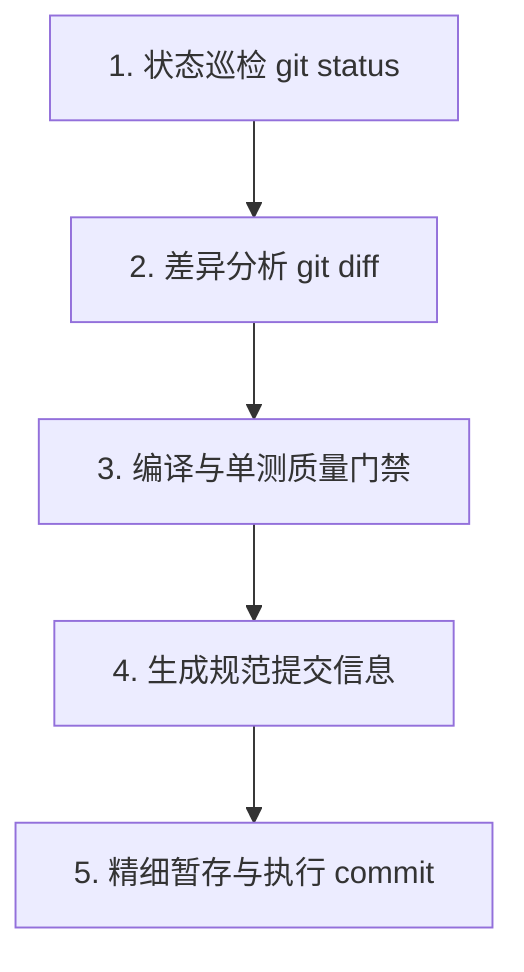

# Git 代码提交工作流 (Git Commit Skill)

本技能为 **LexiLoom** 项目量身定制，用于规范化代码暂存、质量门禁检查、生成符合 Conventional Commits 规范的语义化提交信息，并完成原子化 Git 代码提交。

---

## 核心原则

1. **严禁无脑 `git add .`**：必须仔细检查 `git status`，严格杜绝将本地敏感密钥（如真实 `DASHSCOPE_API_KEY`、私钥）、临时脚本、构建产物（`target/`）或 IDE 缓存提交入库。
2. **规范化提交信息（Conventional Commits）**：统一遵循 `<type>(<scope>): <简明中文摘要>` 格式，必要时附带条目式 Body。
3. **提交前质量门禁**：涉及 Java 核心业务逻辑变更时，必须确保编译无误（`./mvnw test-compile`）或相关单元测试通过，杜绝提交破损代码。

---

## 标准提交五步法



### 步骤一：工作区状态巡检 (Inspect Status)

运行以下命令查看当前工作区状态：
```bash
git status -s
```

**检查清单：**
- **已修改文件（Modified）**：确认改动是否符合预期。
- **未跟踪文件（Untracked `??`）**：
  - 属于项目新增代码/测试/文档的，准备暂存；
  - 属于临时文件（如 `.mcp.json`、临时日志、下载的模型缓存等），应将其加入 `.gitignore`，严防误提。

---

### 步骤二：改动差异分析 (Analyze Diff)

运行以下命令分析具体变更内容与波及范围：
```bash
git diff --stat
git diff
```

根据变更内容识别**领域模块 (Scope)** 与**提交类型 (Type)**：

#### 1. Scope 范围常用枚举：
- `ai` / `ai-trace` / `gateway` / `rag` / `embedding` / `rerank`: AI 智能中枢、检索增强与链路观测
- `document` / `pipeline` / `parser` / `category`: 知识库文档流转、导入流水线与解析引擎
- `search`: Elasticsearch 全文与混合检索模块
- `spacelink`: 跨空间关联与授权检索
- `approval`: 统一审核审批流模块
- `user` / `auth` / `workspace`: 用户、权限认证与工作空间管理
- `config` / `common`: 基础配置、存储适配器与通用工具

#### 2. Type 类型规范：
- `feat`: 新增业务功能、API 端点或核心特性
- `fix`: 修复缺陷、Bug、异常处理或逻辑漏洞
- `refactor`: 代码重构（不改变外部行为，如充血模型重构、防腐层抽取）
- `perf`: 性能调优（如索引优化、减少慢查询、提升并发性能）
- `test`: 新增或修改单元测试、集成测试
- `chore`: 依赖升级、Maven 配置、Docker 配置或环境脚本变动
- `docs`: 文档变更（README、PRD、接口说明等）

---

### 步骤三：质量门禁检查 (Quality Gate)

对于 Java 后端代码的逻辑变更，在提交前必须执行快速编译校验：
```bash
./mvnw test-compile
```
若涉及跨模块、核心 Service 或防腐层改造，运行对应的单元测试确保回归无异常：
```bash
./mvnw test -Dtest=<TargetTestClass>
```
> [!IMPORTANT]
> 若编译报错或单测失败，必须先就地修复问题，严禁带着编译错误强行提交！

---

### 步骤四：构造 Conventional Commits 提交信息

#### 提交信息模板：
```text
<type>(<scope>): <动宾短语描述本次变更核心，50字以内>

[可选详细说明 Body]
- 改造点1：说明具体变更原因与实现方式
- 改造点2：补充关键依赖或影响范围
```

#### 典范示例：
- `feat(ai-trace): 实现全链路 LLM、Embedding 与 Rerank 真实 Token 消耗记录`
- `fix(spacelink): 修复表结构缺失字段并补齐历史审批数据`
- `refactor(event): 替换领域事件监听器为 ApplicationModuleListener`
- `perf(search): 优化多空间联合检索加权合并与候选切片剪枝逻辑`
- `test(ai): 补充 Spring7OpenAiCompatibleEmbeddingModel 真实 Token 采集测试`

---

### 步骤五：精细暂存与提交执行 (Stage & Commit)

1. **精准暂存目标文件**（避免无差别添加）：
   ```bash
   git add <文件1> <文件2> ...
   ```
2. **执行提交**：
   ```bash
   git commit -m "<规范的提交信息>"
   ```
   *（若有长描述 Body，使用多次 `-m` 参数传入）*
3. **输出提交确认**：
   ```bash
   git log -1 --stat
   ```
4. **向用户汇报**：
   - 汇报提交成功的 Commit Hash、分支名称；
   - 摘要汇报提交涵盖的核心文件；
   - 询问用户是否需要执行 `git push` 推送至远程仓库。
