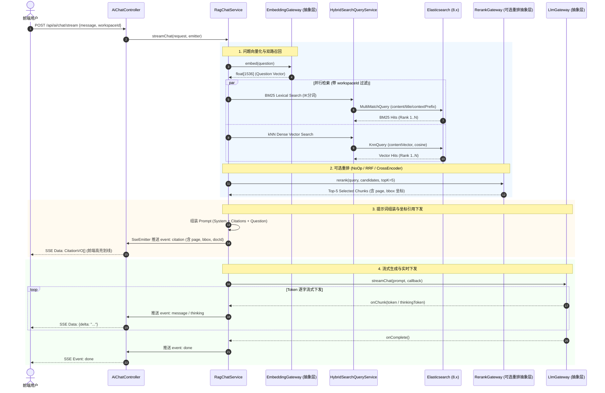

# 阶段四：AI 智能问答与 RAG 检索增强中心（任务实施全景清单）

> **所属项目**：LexiLoom 知识库管理系统  
> **模块定位**：**AI 智能中枢与 RAG 检索增强中心（AI Intelligence & RAG Center）**  
> **架构技术规范**：JDK 25 + Spring Boot 4.x + **Spring AI (spring-ai-core / spring-ai-bom)** + Spring Modulith + Spring Data JPA + Spring Data Elasticsearch (Dense Vector + IK) + CQRS + SSE (Server-Sent Events) + MapStruct + ACL 防腐层 + 充血模型  
> **阶段时间范围（参考）**：第 14 ~ 20 天  
> **核心规范依从**：严格执行 [AGENTS.md](file:///Users/yujian/Downloads/trade/.agents/rules/AGENTS.md) 架构防线（**AI 库强制使用 Spring AI 官方标准框架**、Controller 纯粹性、不可变 record、无大事务网络 IO、ACL 防腐层隔离、MapStruct 映射）  
> **核心设计哲学**：**纯导入型知识库 + DeepDoc 语义原子切块 + 上下文帽子拼接 + 坐标高保真溯源**。彻底杜绝字符滑动窗口与盲目 Overlap，严守 DeepDoc YOLO 版面与 KMeans 行距识别的天然语义边界。

---

## 一、 业务认知重塑：为什么摒弃滑动窗口与 Overlap？

### 1.1 业务认知纠偏：纯导入型知识库的切块哲学

LexiLoom 作为专业内容资产与智能知识库系统，文档资产来源**唯一收敛为外部文件导入（`sourceType = IMPORT`）**，全流程由 **DeepDoc 多格式版面解析引擎**深度驱动：

1. **DeepDoc 的段落切分本身就是语义感知的**：
   - **视觉版面识别**：底层通过 YOLO 模型精确感知文档版面元素（标题 Title、正文 Text、表格 Table、幻灯片 Slide、图注 Figure、页眉页脚）；
   - **几何拓扑聚类**：利用 KMeans 聚类算法分析行间距、段间距与边距缩进，自底向上将视觉相关的文字行聚合为**物理版面与语义逻辑双重完整的原子段落（Atomic Paragraph）**；
   - **高质量元数据绑定**：每个切片直接绑定唯一 `chunkId`、纯净 `content`、类型 `type`、所在页码 `page`、物理矩形框坐标 `bbox: [x0, y0, x1, y1]` 以及结构化锚点 `anchor`。

2. **严禁二次切分与盲目滑动窗口**：
   - 若在 DeepDoc 已经识别好的原子段落之上，再机械地执行固定 Token 长度（如 500 Token）的滑动窗口合并，**等于人为实施破坏性的二次切分**；
   - DeepDoc 已经判定段落 A 和段落 B 是两个独立的语义块，强行将其跨段拼合，**严重违背原始语义识别结果**，容易造成向量表示的主题混杂与漂移。

3. **彻底消灭盲目的 Overlap 重叠窗口**：
   - 真正需要 Overlap 的场景是**无结构纯文本按纯字符长度盲目硬切**（因纯字符切分不懂语法与版面，为了防止生硬斩断句子才被迫加入重叠窗口）；
   - DeepDoc 的段落切分已经具备天然的上下文闭合性，**强行添加 Overlap 既毫无必要，又会在检索候选集中引入大量冗余文本与重复噪声**。

4. **更合理的最佳实践：DeepDoc 原子段落 + "上下文帽子拼接"**：
   - **原子性保护**：直接以 DeepDoc 解析提取的原子段落（`DocTextChunk`）作为检索与切块基本单元（Chunk）；
   - **上下文帽子拼接 (Contextual Header / Prefix Enrichment)**：
     - 在向量化计算（Embedding）与全文索引时，在原子段落前动态拼接一层"上下文帽子"（Context Header）：
       ```
       [文档: 《{docTitle}》] > [章节: {headerPath}] > [类型: {chunkType}]

       {originalParagraphContent}
       ```
     - **双赢收益**：
       - **向量全局感知**：解决短段落脱离上下文后代词指代不明、丢失全文主题词的问题，向量语义相似度大幅提升；
       - **原始边界零破坏**：正文保留原汁原味的段落内容，完美保留 DeepDoc 赋予的 `page` 与 `bbox` 物理坐标，支撑前端在 PDF 原件上进行像素级高亮画框（Visual Grounding）。

---

## 二、 阶段二与阶段三已交付成果（阶段四上游基底）

> 阶段四紧密依托阶段二的 DeepDoc 导入解析底座和阶段三的 Elasticsearch 检索基础设施，完全复用已有成果：

| 已完成模块 | 关键类 / 资产 | 阶段四直接复用点 |
|:---|:---|:---|
| **DeepDoc 结构化解析结果** | [`DocTextChunk`](file:///Users/yujian/Downloads/trade/src/main/java/io/lexiloom/application/document/parser/DocTextChunk.java) / [`DeepDocParsedDocument`](file:///Users/yujian/Downloads/trade/src/main/java/io/lexiloom/application/document/parser/DeepDocParsedDocument.java) | 提供 YOLO + KMeans 解析出的原子段落、页码 `page`、矩形框 `bbox` 及定位锚点 `anchor` |
| **文档领域实体** | [`DocumentEntity`](file:///Users/yujian/Downloads/trade/src/main/java/io/lexiloom/application/document/model/entity/DocumentEntity.java) / [`DocSourceFileEntity`](file:///Users/yujian/Downloads/trade/src/main/java/io/lexiloom/application/document/model/entity/DocSourceFileEntity.java) | 均为 `sourceType = IMPORT`，持有文档标题 `title`、Markdown 文本及关联原件存储路径 |
| **状态机流转事件** | [`DocumentStateTransitionEvent`](file:///Users/yujian/Downloads/trade/src/main/java/io/lexiloom/application/document/statemachine/DocumentStateTransitionEvent.java) | 监听 `PUBLISHED` 触发异步上下文帽子组装与向量化，监听 `ARCHIVED`/`DRAFT` 触发切块物理下线 |
| **ES 8.x 检索基础设施** | `ElasticsearchTemplate` / [`ElasticsearchProperties`](file:///Users/yujian/Downloads/trade/src/main/java/io/lexiloom/application/document/search/ElasticsearchProperties.java) | 原生支持 `dense_vector`（dims=1536，cosine 相似度）与 kNN 向量混合检索 |
| **安全用户上下文** | [`SecurityHolder`](file:///Users/yujian/Downloads/trade/src/main/java/io/lexiloom/application/common/SecurityHolder.java) | 提取当前用户 `userId` 用于工作区隔离、对话会话归属与历史追踪 |
| **统一异常体系** | [`ErrorCode`](file:///Users/yujian/Downloads/trade/src/main/java/io/lexiloom/application/common/ErrorCode.java) / [`BusinessException`](file:///Users/yujian/Downloads/trade/src/main/java/io/lexiloom/application/exception/BusinessException.java) | 扩展 AI 分组错误码（LLM 调用异常、向量化失败、切块解析异常等） |

---

## 三、 阶段四业务全景与架构设计

### 3.1 整体数据流向全景图

```
【离线切块与向量入库链路】
DocumentStateTransitionEvent(PUBLISHED)
       │
       ▼ [Async EventListener] DocVectorSyncListener
       ├─ 获取关联 DocSourceFileEntity 及 DeepDoc 解析结果 (List<DocTextChunk>)
       ├─ [DeepDocContextEnricher] DeepDoc 上下文帽子组装器 (禁止盲目合并与 Overlap):
       │   ├─ 读取 DeepDoc 原子语义段落 (Text / Table / Slide)
       │   ├─ 递归解析 Markdown / 锚点层级面包屑 (headerPath)
       │   └─ 组装上下文帽子: "[文档: 《{title}》] > [章节: {headerPath}]\n\n{content}"
       ├─ [EmbeddingGateway 抽象层] 批量文本向量化 (基于带帽子的 EnrichedText -> float[1536])
       └─ [DocChunkRepository] 保存切块至 ES lexiloom_chunk_index (保留原 content, page, bbox, dense_vector)

【在线 RAG 检索增强对话链路】
前端用户提问 (POST /api/ai/chat/stream)
       │
       ▼ AiChatController (参数校验，无事务)
       ▼ RagChatService (用例编排)
       ├─ [EmbeddingGateway 抽象层] 计算 Question 向量 (float[1536])
       ├─ [HybridSearchQueryService] 双路召回 (ES 8.x):
       │   ├─ 路径 1: BM25 词法关键词召回 (content, title, headerPath, tags)
       │   └─ 路径 2: kNN 向量语义相似度召回 (contentVector cosine 距离)
       ├─ [RerankGateway 抽象层 (可选重排)]:
       │   ├─ 若 enabled=false / NONE: 直接并集打分截断 (零额外开销)
       │   ├─ 若 strategy=RRF: 纯数学倒数排名融合算法 (无外部依赖)
       │   └─ 若 strategy=CROSS_ENCODER: 深度学习模型重排 (BGE-Reranker/DashScope/Cohere)
       ├─ [CitationBuilder] 组装高保真视觉引用溯源 (List<CitationVO>，含 page, bbox 坐标)
       ├─ [RagPromptTemplate] 组装防幻觉 Prompt (System Prompt + Reference Chunks + Question)
       ├─ [LlmGateway 抽象层] 调用 LLM 流式输出 (DeepSeek-V3 / R1 / Qwen / Ollama)
       └─ [SSE 流式推送信道] -> 实时将思考过程、文本 Token 与 Citation 数组推送前端
```

### 3.2 前端分离原则（PRD 指导原则依从）

> **PRD 核心原则**：“把可以留给前端的计算逻辑不要在后端做（这部分留给前端并未实现的要标记一下），优先白嫖用户 CPU，特别繁重的不要在前端。”

- **后端职责（纯粹数据与智能层）**：
  1. 保持 DeepDoc 原子段落纯正性，仅负责上下文帽子拼接、批量向量化、双路混合检索与可选 Rerank 打分；
  2. 负责透传完整的版面元数据（`page` 页码、`bbox` 矩形边界框坐标、`anchor` 锚点定位）；
  3. 负责向前端提供结构化的 SSE 事件流：
     - `event: thinking`：推送深度推理模型的思考过程 Token（针对 DeepSeek-R1）；
     - `event: message`：推送核心回答的正文 Token 增量；
     - `event: citation`：推送结构化引用源数据（包含 `docId`、`docTitle`、`page`、`bbox`、`snippet`、`score`）；
     - `event: done`：推送结束标记与总耗时统计。
- **前端职责（白嫖客户端 CPU 渲染，标记供前端落地）**：
  1. [前端待实现] **PDF 原件划线与高亮画框渲染**：依据 `CitationVO` 下发的 `page` 与 `bbox: [x0, y0, x1, y1]`，在前端 PDF.js / Canvas 上绘制半透明高亮矩形框，点击直接平滑滚动定位到原件对应段落；
  2. [前端待实现] **Markdown 与代码高亮渲染**：使用 `marked` / `markdown-it` + `Prism.js` 客户端渲染；
  3. [前端待实现] **LaTeX 数学公式解析**：使用 `KaTeX` 客户端渲染公式；
  4. [前端待实现] **思考过程折叠组件**：对 `thinking` 流式事件动态呈现 `<details>` 折叠卡片与思考耗时。

---

## 四、 核心架构防腐层设计（三大抽象层基于 Spring AI 驱动）

> **AI 底座核心规范**：所有 LLM 大模型交互与向量化嵌入**强制基于 Spring AI 官方标准生态 (`spring-ai-core`) 构建**。
> `LlmGateway` 与 `EmbeddingGateway` 统一依托 Spring AI 的标准抽象：
> - 大模型交互基于 `org.springframework.ai.chat.model.ChatModel` / `StreamingChatModel` / `ChatClient`；
> - 向量嵌入基于 `org.springframework.ai.embedding.EmbeddingModel`；
> - 严禁裸写低级 HTTP 协议客户端，保持工业级统一调用契约。

```
                    ┌─────────────────────────┐
                    │     业务编排层 (CQRS)     │
                    │      RagChatService     │
                    └────────────┬────────────┘
                                 │
         ┌───────────────────────┼───────────────────────┐
         ▼                       ▼                       ▼
┌──────────────────┐    ┌──────────────────┐    ┌──────────────────┐
│   LlmGateway     │    │ EmbeddingGateway │    │  RerankGateway   │
│   (Spring AI 驱动)│    │  (Spring AI 驱动)│    │ (重排抽象层-可选) │
└────────┬─────────┘    └────────┬─────────┘    └────────┬─────────┘
         │ SPI                   │ SPI                   │ SPI
  ┌──────┴──────┐         ┌──────┴──────┐         ┌──────┴──────┐
  ├─ DeepSeek   │         ├─ OpenAI-Comp│         ├─ NoOp (关闭)│
  ├─ Qwen       │         ├─ Ollama     │         ├─ RRF (纯算法)
  ├─ Ollama     │         └─ Mock       │         ├─ CrossEncode│
  └─ Mock       │                                 └─ Mock       │
  (基于 Spring AI ChatModel) (基于 Spring AI EmbeddingModel)
```

### 4.1 大模型抽象层：`LlmGateway`（基于 Spring AI 标准契约）
- **统一接口契约**：
  ```java
  public interface LlmGateway {
      AiChatResponse chat(LlmChatCommand command);
      void streamChat(LlmChatCommand command, LlmStreamCallback callback);
  }
  ```
- **Spring AI 驱动与 SPI 适配器矩阵**：
  - 基于 Spring AI `ChatModel` 与 `StreamingChatModel` 驱动；
  - `DeepSeekLlmAdapter`：基于 Spring AI 对接 DeepSeek-V3 / DeepSeek-R1（解析 `reasoning_content` 思维链）；
  - `QwenLlmAdapter`：基于 Spring AI 对接阿里通义千问（DashScope API）；
  - `OllamaLlmAdapter`：基于 Spring AI Ollama 支持适配本地私有化部署模型（如 `qwen2.5:7b`、`deepseek-r1:8b`）；
  - `MockLlmAdapter`：测试与断网降级桩，零外部依赖保障单测百分之百稳定。

### 4.2 向量化抽象层：`EmbeddingGateway`（基于 Spring AI EmbeddingModel）
- **统一接口契约**：
  ```java
  public interface EmbeddingGateway {
      float[] embed(String text);
      List<float[]> embedBatch(List<String> texts);
      int getDimension();
  }
  ```
- **Spring AI 驱动与 SPI 适配器矩阵**：
  - 基于 Spring AI `org.springframework.ai.embedding.EmbeddingModel` 驱动；
  - `OpenAiCompatibleEmbeddingAdapter`：基于 Spring AI OpenAI/DashScope 嵌入接口；
  - `OllamaEmbeddingAdapter`：基于 Spring AI Ollama 嵌入服务（`bge-m3` 等）；
  - `MockEmbeddingAdapter`：基于文本内容哈希生成的伪随机归一化单位向量（1536 维），断网环境开箱即用。

### 4.3 重排抽象层：`RerankGateway`（完全可选与可插拔）
- **统一接口契约**：
  ```java
  public interface RerankGateway {
      List<ScoredDocChunkVO> rerank(RerankCommand command);
      boolean isEnabled();
  }
  ```
- **SPI 适配器矩阵**：
  1. `NoOpRerankAdapter`（**默认关闭/透传**）：当 `enabled=false` 时生效，零额外时延直接按并集打分截断；
  2. `RrfRerankAdapter`（**纯算法重排**）：基于倒数排名融合算法（RRF, $k=60$），纯内存运行，零 API 调用成本；
  3. `CrossEncoderRerankAdapter`（**深度模型重排**）：调用外部 Cross-Encoder Rerank API（DashScope / Jina / Cohere / Ollama）；
  4. `MockRerankAdapter`：测试模拟桩。

---

## 五、 详细任务分解清单 (Task Breakdown)

### 任务组 1：配置项与属性类设计

- [x] **1.1 配置项与属性类设计 (`AiProperties`)**
  - 新增配置类 `AiProperties`（`@ConfigurationProperties(prefix = "lexiloom.ai")`）：
    - `enabled`: 布尔值开关
    - `model-provider`: 枚举 `DEEPSEEK`, `QWEN`, `OLLAMA`, `MOCK`（默认 MOCK）
    - `api-key`, `base-url`, `chat-model`, `reasoning-model`
    - `embedding`:
      - `provider`: `OPENAI_COMPATIBLE`, `DASHSCOPE`, `OLLAMA`, `MOCK`
      - `model`: 模型名称（如 `text-embedding-v3`）
      - `dimension`: 向量维度（默认 1536）
    - `rerank`（**重排可插拔配置**）：
      - `enabled`: 布尔值（默认 `false`，设计为完全可选）
      - `strategy`: 枚举 `NONE`, `RRF`, `CROSS_ENCODER`, `MOCK`（默认 `NONE`）
      - `provider`: `DASHSCOPE`, `JINA`, `COHERE`, `SILICONFLOW`, `OLLAMA`
      - `model`: 模型名称（如 `gte-rerank` 或 `bge-reranker-v2-m3`）
      - `top-k`: 重排截取数（默认 5）
      - `min-score`: 相似度过滤阈值（默认 0.60）
    - `chunk`（**彻底移除滑动窗口，配置上下文帽子与 DeepDoc 相关参数**）：
      - `context-prefix-enabled`: 布尔值（默认 `true`，是否开启上下文帽子拼接）
      - `max-token-limit`: 单段极端防御性上限（默认 2000，防止异常脏数据超限）
    - `rag`:
      - `top-k`: 召回切片数（默认 5）
      - `similarity-threshold`: 最小相关度阈值（默认 0.60）
  - 更新 `application.yaml` 与 `application-local.yaml` 配置样例。

- [x] **1.2 异常码扩充**
  - 在 [`ErrorCode.java`](file:///Users/yujian/Downloads/trade/src/main/java/io/lexiloom/application/common/ErrorCode.java) 中增加 `Ai` 错误码枚举：
    - `LLM_API_ERROR` (500, "大模型接口远程调用失败")
    - `EMBEDDING_FAILED` (500, "文本向量化计算失败")
    - `RERANK_FAILED` (500, "重排模型调用失败")
    - `CHUNK_SPLIT_FAILED` (400, "DeepDoc切块解析组装失败")
    - `HYBRID_SEARCH_FAILED` (500, "双路混合召回执行失败")
    - `SESSION_NOT_FOUND` (404, "对话会话不存在或已过期")

---

### 任务组 2：领域模型与向量实体设计（支持坐标溯源）

- [x] **2.1 ES 切块实体 `DocChunkDocument`**
  - 路径：`ai/model/search/DocChunkDocument.java`
  - 索引名称：`#{@aiProperties.chunkIndexName}`（默认 `lexiloom_chunk_index`）
  - 字段定义：
    - `id` (`@Id`, Keyword) - `documentId_chunkIndex`
    - `workspaceId` (Keyword, 必须索引过滤)
    - `documentId` (Keyword)
    - `chunkIndex` (Integer) - 原子段落序号
    - `chunkId` (Keyword) - DeepDoc 原生切片 ID（如 `chunk_p_0`, `docx_p_1`）
    - `title` (Text + IK) - 归属文档标题
    - `headerPath` (Keyword) - 章节导航层级面包屑路径
    - `content` (Text + IK) - **原子段落纯净原文（保持 DeepDoc 原始边界）**
    - `contextPrefix` (Text) - **上下文帽子前缀文本**
    - `contentVector` (`@Field(type = FieldType.Dense_Vector, dims = 1536)`) - 基于带帽子的完整语义文本生成的 Dense Vector
    - `page` (Integer) - **PDF / 原件页码（用于原件渲染直达）**
    - `bbox` (Float[]) - **矩形框边界坐标 `[x0, y0, x1, y1]`（用于原件高亮划线）**
    - `chunkType` (Keyword) - 切片类型（text / table / slide 等）
    - `anchor` (Keyword) - 定位锚点（如 "段落_1", "表格_1"）
    - `tags` (List<Keyword>)
    - `categoryId` (Keyword)
    - `updateTime` (Date)

- [x] **2.2 ES 切块 Repository `DocChunkRepository`**
  - 继承 `ElasticsearchRepository<DocChunkDocument, String>`；
  - 声明原生派生查询：
    - `deleteByWorkspaceIdAndDocumentId(String workspaceId, String documentId)`
    - `findByWorkspaceIdAndDocumentId(String workspaceId, String documentId)`

- [x] **2.3 自动初始化索引组件 `AiIndexInitializer`**
  - 在应用启动时（`@PostConstruct`），通过 `IndexOperations` 校验并自动创建 `lexiloom_chunk_index` 及其 Mapping 结构。

- [x] **2.4 传输对象与值对象设计（全不可变 Java `record`）**
  - `DocChunkVO(documentId, chunkIndex, headerPath, content, similarityScore, page, bbox, chunkType)`
  - `CitationVO(citationIndex, documentId, docTitle, headerPath, snippet, score, page, bbox, chunkType, anchor)`
  - `AiChatRequest(@NotBlank message, @NotNull workspaceId, String sessionId, Boolean enableThinking)`
  - `AiChatChunkResponse(String type, String delta, List<CitationVO> citations)`（type 取值：`THINKING`, `MESSAGE`, `CITATION`, `DONE`）
  - `AiChatResponse(String content, String thinkingContent, List<CitationVO> citations, long latencyMs)`

---

### 任务组 3：三大模型抽象防腐层（基于 Spring AI 官方标准框架）

- [x] **3.1 大模型抽象防腐层 `LlmGateway`（基于 Spring AI `ChatModel` / `StreamingChatModel`）**
  - 统一调用契约：`LlmChatCommand`、`LlmStreamCallback`、`LlmGateway`
  - 底层基于 Spring AI 驱动，严禁手写 HTTP 客户端；
  - 实现类：`DeepSeekLlmAdapter` (Spring AI), `QwenLlmAdapter` (Spring AI), `OllamaLlmAdapter` (Spring AI Ollama), `MockLlmAdapter`, `DefaultLlmGateway`
  - 核心能力：解析 DeepSeek-R1 / Qwen 思维链推理过程（`reasoning_content` / thinking token），并桥接到流式回调。

- [x] **3.2 向量化抽象防腐层 `EmbeddingGateway`（基于 Spring AI `EmbeddingModel`）**
  - 统一计算契约：单条 `embed(text)`、批量 `embedBatch(texts)`
  - 底层基于 Spring AI `org.springframework.ai.embedding.EmbeddingModel` 驱动；
  - 实现类：`OpenAiCompatibleEmbeddingAdapter` (Spring AI), `OllamaEmbeddingAdapter` (Spring AI Ollama), `MockEmbeddingAdapter`, `DefaultEmbeddingGateway`

- [x] **3.3 重排模型抽象防腐层 `RerankGateway`（可插拔与可选）**
  - 统一重排契约：`RerankCommand`, `RerankGateway`
  - 实现类：`NoOpRerankAdapter` (默认透传), `RrfRerankAdapter` (RRF算法), `CrossEncoderRerankAdapter` (深度模型), `MockRerankAdapter`

---

### 任务组 4：DeepDoc 原子段落提取与上下文帽子组装管线

- [x] **4.1 DeepDoc 上下文帽子组装器 `DeepDocContextEnricher`**
  - 路径：`ai/chunk/DeepDocContextEnricher.java`
  - **核心理念**：彻底替代传统的 `RecursiveTextSplitter`。坚决不做滑动窗口合并，坚决不加 Overlap！
  - **算法步骤**：
    1. **读取 DeepDoc 原子切片**：从文档导入解析结果中提取结构化的 `List<DocTextChunk>`（来自阶段二/三落盘资产或源文件元数据）；
    2. **标题面包屑层级推导**：基于 Markdown 标题层级树或 DeepDoc 锚点定位，推导段落所属的章节面包屑（如 `技术架构 / 存储设计 / 向量索引`）；
    3. **上下文帽子动态合成**：为每个原子段落生成上下文前缀：
       ```java
       String prefix = String.format("[文档: 《%s》] > [章节: %s] > [类型: %s]

", title, headerPath, chunk.type());
       String enrichedText = prefix + chunk.content();
       ```
    4. **元数据完全保真**：将原始 `content`、`page`、`bbox` 坐标、`anchor`、`chunkId` 与合成的 `enrichedText` 封装为 `EnrichedDocChunk` 对象。

- [x] **4.2 异步切块与向量入库监听器 `DocVectorSyncListener`**
  - 路径：`ai/listener/DocVectorSyncListener.java`
  - 注解：`@Async @EventListener` 监听 `DocumentStateTransitionEvent`；
  - 业务逻辑：
    - 当状态为 `PUBLISHED` 时：
      1. 获取当前文档实体与关联 `DocSourceFileEntity`；
      2. 调用 `DeepDocContextEnricher.enrich(doc, sourceFile)` 获取带帽子的原子切片列表；
      3. 提取所有切片的 `enrichedText`，批量调用 `EmbeddingGateway.embedBatch(...)` 计算向量；
      4. 组装 `DocChunkDocument`（存入原段落 content、page、bbox 坐标及 contentVector），批量写入 `DocChunkRepository`；
      5. 记录切块入库数量与向量化耗时。
    - 当状态为 `ARCHIVED` 或 `DRAFT` 时：
      - 调用 `DocChunkRepository.deleteByWorkspaceIdAndDocumentId(...)` 物理删除切块。

---

### 任务组 5：双路召回与可选重排引擎

- [x] **5.1 混合召回服务 `HybridSearchQueryService`**
  - 路径：`ai/search/HybridSearchQueryService.java`
  - 并行执行双路召回：
    - **路径 1（词法全文召回）**：`NativeQuery`，对 `content` / `title` / `contextPrefix` 进行 IK 分词匹配，加带 `workspaceId` 必须过滤；
    - **路径 2（稠密向量召回）**：ES 8.x `knn` query，计算问题向量与 `contentVector` 的 Cosine 相似度，加带 `workspaceId` 必须过滤；
    - **召回汇聚**：汇总候选集 `List<DocChunkCandidate>`。

- [x] **5.2 委托 `RerankGateway` 精排（可选流转）**
  - 交付 `rerankGateway.rerank(RerankCommand.of(query, candidates, topK))`；
  - 若未开启重排，自动由 `NoOpRerankAdapter` 快速截取返回；若开启则执行 RRF 或 Cross-Encoder 打分。

- [x] **5.3 视觉坐标引用源构建器 `CitationBuilder`**
  - 路径：`ai/search/CitationBuilder.java`
  - 将精排选出的切片映射为 `CitationVO`，除了标号与摘要，**必须完整携带 `page` 页码、`bbox` 坐标与 `anchor` 锚点**，赋能前端 PDF 原件精准高亮定位。

---

### 任务组 6：RAG 提示词编排与对话会话管理

- [x] **6.1 提示词模板 `RagPromptTemplate`**
  - 注入防幻觉系统人设，要求回答严格基于知识库参考片段，并在正文自然标注 `[1]`, `[2]` 引用角标；
  - 支持多轮对话历史上下文窗口拼接（最多保留最近 3 轮）。

- [x] **6.2 会话管理服务 `ConversationSessionService`**
  - 基于 Redis（`ll:ai:session:{sessionId}`）维护多轮消息上下文，设置滑动过期时间。

- [x] **6.3 核心编排服务 `RagChatService`**
  - 同步模式：`chat(...)` $
ightarrow$ 向量化 $
ightarrow$ 双路召回与重排 $
ightarrow$ 组装 Prompt $
ightarrow$ 调用 LLM $
ightarrow$ 返回完整响应；
  - 流式模式：`streamChat(...)` $
ightarrow$ 双路召回与重排 $
ightarrow$ 优先下发 `citation` 结构化引用事件 $
ightarrow$ 流式下发 `message` / `thinking` $
ightarrow$ 下发 `done`。

---

### 任务组 7：Controller 接口暴露（REST + SSE）

- [x] **7.1 新增 `AiChatController`**
  - 基础路径：`/api/ai`
  - 接口清单：

  | Method | Path | 参数 / 格式 | 说明 |
  |---|---|---|---|
  | `POST` | `/api/ai/chat/stream` | `AiChatRequest`（JSON） | **核心接口**：SSE 流式对话（返回 `SseEmitter`） |
  | `POST` | `/api/ai/chat` | `AiChatRequest`（`@Valid`） | 同步阻塞式对话（返回 `AiChatResponse`） |
  | `GET` | `/api/ai/chunks/{docId}` | `@PathVariable Long docId` | 查看某文档 DeepDoc 原子切块详情、上下文帽子及坐标数据 |
  | `POST` | `/api/ai/reindex/{docId}` | `@PathVariable Long docId` | 手动触发单文档重新执行上下文帽子组装与向量化入库 |

---

### 任务组 8：单元测试与领域行为覆盖

- [x] **8.1 DeepDoc 上下文帽子组装测试 `DeepDocContextEnricherTest`**
  - 覆盖：
    1. 原子段落边界严守测试（段落数与 DeepDoc 输出 1:1，绝不发生跨段合并）；
    2. 上下文帽子前缀生成格式正确性（`[文档: 《...》] > [章节: ...]`）；
    3. `page` 与 `bbox` 物理坐标无损透传；
    4. 无章节标题时的降级处理；
    5. 表格（table）与幻灯片（slide）特殊切片类型的帽子组装与边界保护；
    6. 防御性极端超长文本安全截断保护。

- [x] **8.2 向量与大模型防腐层测试 `EmbeddingGatewayTest` & `LlmGatewayTest`**
  - 覆盖：Mock 向量维度合规性（1536 维）、流式回调消费、异常降级与 Provider 动态切换。

- [x] **8.3 重排抽象层测试 `RerankGatewayTest`**
  - 覆盖：`NoOpRerankAdapter` 零开销透传、`RrfRerankAdapter` 倒数排名打分、`CrossEncoderRerankAdapter` 外部调用与 Mock 降级。

- [x] **8.4 双路混合召回测试 `HybridSearchQueryServiceTest`**
  - 验证：BM25 与 kNN 检索均强制带工作空间隔离过滤器；双路候选集正确汇聚。

- [x] **8.5 坐标引用构建与 RAG 编排测试 `CitationBuilderTest` & `RagChatServiceTest`**
  - 验证：`CitationVO` 准确绑定 `page` 与 `bbox` 坐标；Prompt 注入精准切片编号；防幻觉兜底机制。

- [x] **8.6 控制器与 SSE 流式测试 `AiChatControllerTest`**
  - 验证：SSE 握手、参数校验拦截、事件推送格式（`thinking`, `message`, `citation`, `done`）。

---

## 六、 端到端核心时序图 (End-to-End Sequence Diagram)



---

## 七、 实施路线图（分步推进计划）

| 实施步骤 | 核心交付成果 | 关键文件 |
|:---|:---|:---|
| **Step 4.1：基础设施与配置 (✅ 已完成)** | 新增 AI 配置类（上下文帽子配置、大模型、向量化、可选重排）、错误码扩充 | `AiProperties.java`, `ErrorCode.java`, `application.yaml` |
| **Step 4.2：ES 切块实体与 Mapping (✅ 已完成)** | 支持 `bbox`、`page` 坐标的切块实体、Repository 与自动索引初始化组件 | `DocChunkDocument.java`, `DocChunkRepository.java`, `AiIndexInitializer.java` |
| **Step 4.3：模型、向量与重排三大防腐层 (基于 Spring AI) (✅ 已完成)** | 基于 Spring AI (`ChatModel`, `StreamingChatModel`, `EmbeddingModel`) 的大模型与向量防腐层，及可选 `RerankGateway` | `LlmGateway.java`, `EmbeddingGateway.java`, `RerankGateway.java`, `*Adapter.java` |
| **Step 4.4：DeepDoc 原子切片与上下文帽子管线 (✅ 已完成)** | `DeepDocContextEnricher` 上下文帽子组装器、监听发布事件异步入库向量 | `DeepDocContextEnricher.java`, `DocVectorSyncListener.java` |
| **Step 4.5：双路检索与精排编排引擎 (✅ 已完成)** | BM25 + kNN 并行召回、集成 `RerankGateway` 精排融合、视觉坐标引用构建器 | `HybridSearchQueryService.java`, `CitationBuilder.java` |
| **Step 4.6：RAG 提示词编排与会话管理 (✅ 已完成)** | 提示词模板注入防幻觉边界、多轮会话窗口管理、RAG 核心编排服务 | `RagPromptTemplate.java`, `ConversationSessionService.java`, `RagChatService.java` |
| **Step 4.7：Controller 接口暴露 (REST + SSE) (✅ 已完成)** | 暴露流式 SSE 问答端点与阻塞问答端点、切块详情巡检与重建索引 | `AiChatController.java` |
| **Step 4.8：单元测试全覆盖 (✅ 已完成)** | 上下文帽子组装器、大模型网关、向量网关、重排网关、混合召回、RAG 编排、Controller 单元测试 (75 个单测全绿) | `*Test.java` (13 大测试用例套件) |
