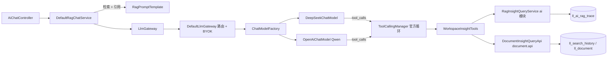

# AI 对话重构为官方 Spring AI + `@Tool` 工具调用 MVP:执行文档

> 状态:待执行　|　范围:`io.lexiloom.application.ai`、`document.api`、`pom.xml`
> 重点:**第一部分(Phase 0–3)把手写 HTTP 的 ChatModel 迁移到官方 Spring AI**;第二部分(Phase 4)用最小 MVP 落地 3 个"空间洞察"工具。

---

## 0. 背景与决策

| 项 | 结论 |
|---|---|
| 为什么迁移 | [Spring7OpenAiCompatibleChatModel](../src/main/java/io/lexiloom/application/ai/gateway/llm/Spring7OpenAiCompatibleChatModel.java) 手写 `HttpClient`,请求体只有 `model/messages/stream`,**没有 `tools`,也不解析 `tool_calls`**。此外它违反规范第 1.8 条(禁止手写裸 HTTP)。 |
| 当时为什么手写 | 项目是 Spring Boot 4.1.1 / Framework 7,而 `pom.xml` 里的 `spring-ai 1.0.0-M5` 是 Boot 3 时代的版本,与 Boot 4 不兼容。 |
| 目标版本 | **Spring AI 2.0.2**(Maven Central 已有 2.0.0 / 2.0.1 / 2.0.2 GA,基线为 Boot 4 / Framework 7,Jackson 3)。 |
| 依赖选型 | 使用 **模型模块** `spring-ai-openai`(Qwen / DashScope 兼容模式)和 `spring-ai-deepseek`(DeepSeek,支持 `reasoning_content`),**不引入 starter**。原因:项目已有 `AiProperties` 和 BYOK 动态路由,不使用自动装配,避免 Bean 冲突。 |
| 防腐层 | 保持 [`LlmGateway`](../src/main/java/io/lexiloom/application/ai/gateway/llm/LlmGateway.java) 契约不变,上层 `DefaultRagChatService` 不感知迁移。 |
| 工具调用 | 使用 Spring AI 官方 `@Tool` + `ToolCallingChatOptions` + `ToolContext`。工具调用循环由框架完成,不自己实现。 |
| MVP 工具 | 只做 3 个:`get_hot_questions`、`get_hot_search_keywords`、`get_hot_documents`。 |
| 回滚 | 迁移期保留旧实现,用开关 `lexiloom.ai.engine=spring-ai|legacy` 切换,稳定一个版本后再删除。 |

> [!IMPORTANT]
> Phase 0 的 Spike 任何一项不通过,都要先和负责人对齐再往下做(尤其是 BYOK 与 DeepSeek 推理内容)。文中涉及 Spring AI 2.0 具体 API 的地方都标注了"以 Spike 为准"。

---

## 1. 现状要点(已核对代码)

1. [`AiModelConfiguration`](../src/main/java/io/lexiloom/application/ai/config/AiModelConfiguration.java) 创建 `deepSeekChatModel`、`qwenChatModel` 两个 `Spring7OpenAiCompatibleChatModel`,以及一个 `Spring7OpenAiCompatibleEmbeddingModel`。
2. **BYOK**:`Spring7OpenAiCompatibleChatModel.resolveEffectiveApiKey()` 在**每次请求**时从 `SecurityHolder.getOpenApiPrincipal()` 读取用户自带的 `llmApiKey`,优先于系统 Key。[`DefaultLlmGateway.selectAdapter()`](../src/main/java/io/lexiloom/application/ai/gateway/llm/DefaultLlmGateway.java) 同样按 `llmProvider` 路由。**官方 ChatModel 的 Key 在构建时固定,这是迁移的最大难点。**
3. **思维链**:现有模型把 `reasoning_content` 包成 `<think>...</think>` 文本,由 [`SpringAiChatModelAdapter`](../src/main/java/io/lexiloom/application/ai/gateway/llm/SpringAiChatModelAdapter.java) 拆成 `onThinking/onMessage`。
4. `SpringAiChatModelAdapter` 已经基于 `ChatModel` 抽象,`LlmChatCommand → Prompt` 的转换在 `buildSpringAiPrompt`。**适配层大部分可以保留。**
5. 主流程 [`DefaultRagChatService`](../src/main/java/io/lexiloom/application/ai/rag/DefaultRagChatService.java):先检索,再 `RagPromptTemplate` 拼 Prompt,最后调用 `llmGateway.streamChat`。
6. `RagPromptTemplate.DEFAULT_SYSTEM_PROMPT` 第 2 条要求"参考资料没有就回答未找到",**与工具调用冲突**,需要调整。
7. 观测:`RagTraceHolder` 基于 `ScopedValue`。

---

## 2. 目标架构



关键设计点:

- **`ChatModelFactory`(新增)**:解决 BYOK。按 `(provider, baseUrl, sha256(apiKey))` 缓存官方 `ChatModel` 实例;系统默认 Key 对应的实例在启动时构建。BYOK 请求拿到的是以用户 Key 构建的实例。缓存要有上限和过期(Caffeine,Spring Boot 已托管),Key 只存哈希,不落日志。
- **`workspaceId`、`userId` 不由 LLM 传参**。通过 `ToolContext` 传入,由 `DefaultRagChatService` 在入口根据已校验的请求生成。这样即使发生提示词注入,模型也无法越权查看其他空间。
- 工具循环可能在 Reactor 线程上执行,`ScopedValue` 不会跨线程传播,所以工具里**不要依赖 `SecurityHolder` / `RagTraceHolder`**,只用 `ToolContext`。
- 模块边界:`ai` 模块不能直接访问 `document` 的 Repository,统一通过 `document.api`(`@NamedInterface`)暴露查询接口。

---

## 3. 执行计划

### Phase 0:Spike(0.5–1 天,不合并主干)

在独立分支做最小验证,产出结论记录在 PR 描述里。

| # | 验证项 | 通过标准 |
|---|---|---|
| S1 | `pom.xml` 引入 BOM 2.0.2 + `spring-ai-openai` + `spring-ai-deepseek`,工程在 Boot 4.1.1 + JDK 25 下编译、启动 | `mvn -q verify -DskipTests` 通过,应用能启动,无 Bean 冲突 |
| S2 | 用 `baseUrl`/`apiKey` 构建 `DeepSeekChatModel` 和 `OpenAiChatModel`(指向 DashScope compatible-mode),跑通同步和流式 | 能正常返回,流式能拿到 usage |
| S3 | **DeepSeek `reasoning_content`** 能拿到(官方 `DeepSeekAssistantMessage.getReasoningContent()` 或元数据) | 流式下思维链和正文可以分开拿到 |
| S4 | **BYOK**:确认是"每次请求构建/缓存新实例"还是 `mutate()` / 运行时 options 覆盖 Key 更合适 | 选定方案并验证 100 次构建的开销和内存可接受 |
| S5 | **工具调用**:一个 `@Tool` 方法 + `ToolContext`,分别在 DeepSeek 和 Qwen 上跑通同步和**流式**(tool_calls 增量拼接) | 模型能正确调用、拿到 `ToolContext`、最终给出回答 |
| S6 | 流式工具循环所在线程,确认 `ScopedValue` 是否传播(预期不传播) | 记录结论;若不传播则坚持只用 `ToolContext` |
| S7 | `enableThinking` 的映射:现在是切到 `reasoningModel`,确认官方模型下如何通过 options 的 `model` 实现 | 与现状行为一致 |
| S8 | DeepSeek `deepseek-reasoner` 是否支持工具调用 | 不支持则开启思考时关闭工具(见 §5.3) |

> [!WARNING]
> 若 S3 失败(官方模块丢失 `reasoning_content`):降级方案是 DeepSeek 继续使用 `spring-ai-openai` 并自定义 `ChatModel` 装饰器解析该字段;仍然不手写 HTTP。若 S4 失败:该用户 BYOK 走一次性构建的实例,不缓存。

### Phase 1:依赖与 ChatModel 迁移(核心,约 2–3 天)

**1.1 `pom.xml`**
```xml
<spring-ai.version>2.0.2</spring-ai.version>
...
<!-- 替换 spring-ai-core -->
<dependency><groupId>org.springframework.ai</groupId><artifactId>spring-ai-openai</artifactId></dependency>
<dependency><groupId>org.springframework.ai</groupId><artifactId>spring-ai-deepseek</artifactId></dependency>
```
BOM 的 `dependencyManagement` 已存在,只需要改版本号。`spring-ai-core` 会作为传递依赖带入。

**1.2 新增 `ai/gateway/llm/ChatModelFactory`**

```java
/** 按 provider + baseUrl + apiKey 获取官方 Spring AI ChatModel,支持 BYOK 缓存 */
@Component
public class ChatModelFactory {
  /** 系统默认模型(启动时构建);BYOK 模型走 Caffeine 缓存 */
  public ChatModel resolve(LlmModelProviderEnum provider, @Nullable String byokApiKey) { ... }
}
```
- 实现细节以 S2/S4 的 Spike 结果为准。
- 默认值沿用 `AiModelConfiguration` 现有逻辑:DeepSeek `https://api.deepseek.com`、Qwen `https://dashscope.aliyuncs.com/compatible-mode/v1`。Qwen 模型名目前写死 `qwen3.8-flash`,借此迁移顺手挪到 `AiProperties`(新增 `qwen-chat-model`,默认值不变)。
- 符合规范第 1.13 条(OpenAI Compatible 形式)。

**1.3 改造 `AiModelConfiguration`**
- `deepSeekChatModel` / `qwenChatModel` 两个 Bean 改为通过 `ChatModelFactory` 构建官方实现。
- 按 `lexiloom.ai.engine` 条件装配:`spring-ai`(默认)使用新实现,`legacy` 保留旧的 `Spring7OpenAiCompatibleChatModel`。
- Embedding 本阶段**不动**。

**1.4 改造 `SpringAiChatModelAdapter` / `DeepSeekLlmAdapter` / `QwenLlmAdapter`**
- `chatModel` 不再是启动时固定的实例,而是在调用时通过 `ChatModelFactory.resolve(provider, byokKey)` 获取。BYOK Key 从 `SecurityHolder.getOpenApiPrincipal()` 读取(原来在旧 ChatModel 内部,现在上移到适配层,**这是行为迁移点,要有测试覆盖**)。
- 思维链:优先从官方响应中取 `reasoning_content`;`<think>` 标签拆分逻辑保留作为兜底,不删除。
- `buildSpringAiPrompt` 返回的 `Prompt` 使用 `ChatOptions`/`ToolCallingChatOptions` 携带 `model`、`temperature`。
- **在 `LlmChatCommand` 增加两个可选字段**(见 Phase 4):`List<ToolCallback> toolCallbacks`、`Map<String,Object> toolContext`,默认空,不影响现有调用方。

**1.5 回归测试(必须)**
- 改造 `LlmGatewayTest`、`RagChatServiceTest`:使用 Mockito mock 官方 `ChatModel`,覆盖同步、流式、`<think>` 拆分、BYOK 路由、Key 缺失报错。
- 新增 `ChatModelFactoryTest`:默认实例、BYOK 缓存命中、不同 Key 隔离、Key 不出现在日志。
- 手工回归:本地环境用真实 Key 跑一次 Web 对话(流式 + 思考模式)、一次 OpenAPI 对话(BYOK)。

### Phase 2:观测与限流对接(约 0.5 天)

- `usage` 回传链路 `traceContext.recordLlmTokens(...)` 保持不变,确认官方流式响应能拿到 `Usage`(需要 `stream_options.include_usage`,官方模块默认处理,Spike S2 已验证)。
- 增加日志:迁移前后各 3 个相同问题,对比 token、耗时、回答长度,确认无明显劣化。

### Phase 3:清理(约 0.5 天,**合并并稳定运行一个版本后**再做)

- 删除 `Spring7OpenAiCompatibleChatModel` 及其测试、`engine=legacy` 分支。
- 删除 `AiProperties` 里不再使用的字段(若有)。
- 更新 `README`/`application.yaml` 注释。

### Phase 4:工具调用 MVP(约 2 天)

#### 4.1 范围

| 工具 | 回答的问题 | 数据来源 |
|---|---|---|
| `get_hot_questions(days, topN)` | 当前空间最近大家问得最多的问题 | `ll_ai_rag_trace.query` 按空间聚合 |
| `get_hot_search_keywords(days, topN)` | 热门搜索词 | `ll_search_history.keyword` 按空间聚合 |
| `get_hot_documents(topN)` | 阅读最多的文档 | `ll_document.read_count` 排序 |

不在 MVP:知识盲区(检索为空/差评的问题)、文档详情、目录结构、写操作。它们会在 §8 的后续计划里。

> [!NOTE]
> `read_count` 是**累计值**,没有时间维度,所以 `get_hot_documents` 不接收 `days` 参数,工具描述里要明确写"累计阅读量"。若以后要"近 7 天热门",需要新增阅读日志表或每日聚合表。

#### 4.2 新增/修改文件

| 文件 | 说明 |
|---|---|
| `ai/tool/WorkspaceInsightTools.java` | 只含 3 个 `@Tool` 方法,不含业务逻辑,调用 Service |
| `ai/tool/ToolInvocationContext.java` | `record(Long workspaceId, Long userId)`,`static from(ToolContext)`,缺失时抛 `BusinessException` |
| `ai/tool/model/HotQuestionVO.java`、`HotKeywordVO.java`、`HotDocumentVO.java` | 返回 record,字段脱敏(不含 userId) |
| `ai/insight/RagInsightQueryService.java` | QueryDsl 聚合 `RagTraceEntity` |
| `document/api/DocumentInsightQueryApi.java` + 实现 `document/service/impl/DocumentInsightQueryApiImpl.java` | 热门搜索词、热门文档,放在 `document.api` 命名接口内 |
| `document/repository/SearchHistoryRepository` | 增加聚合查询(QueryDsl 自定义实现) |
| `ai/config/AiProperties` | 新增 `tools.enabled`(默认 `false`)、`tools.max-top-n`(20)、`tools.max-days`(90) |
| `ai/rag/RagPromptTemplate` | 调整 system prompt(见 4.5) |
| `ai/rag/DefaultRagChatService` | 在构建 `LlmChatCommand` 时注入工具与上下文 |

#### 4.3 工具类骨架

```java
/** 空间洞察工具集(只读)。workspaceId/userId 一律取自 ToolContext,不接受模型传参 */
@Component
@RequiredArgsConstructor
public class WorkspaceInsightTools {

  private final RagInsightQueryService ragInsightQueryService;
  private final DocumentInsightQueryApi documentInsightQueryApi;
  private final AiProperties aiProperties;

  @Tool(name = "get_hot_questions",
      description = "统计当前空间内用户向 AI 助手提问最多的问题,按提问次数倒序。用于回答“最近大家最常问什么”")
  public List<HotQuestionVO> getHotQuestions(
      @ToolParam(description = "统计最近多少天,默认7", required = false) Integer days,
      @ToolParam(description = "返回条数,默认5", required = false) Integer topN,
      ToolContext toolContext) {
    var ctx = ToolInvocationContext.from(toolContext);
    return ragInsightQueryService.hotQuestions(
        ctx.workspaceId(), clampDays(days), clampTopN(topN));
  }
  // get_hot_search_keywords / get_hot_documents 同理
}
```

- 参数范围用 `Math.clamp` 限制,数值上限取自 `AiProperties.tools`。
- 返回值是 record 列表,序列化由框架负责;每条文本截断到 100 字,避免撑爆上下文。
- 方法内部异常:捕获 `BusinessException`,返回对模型可读的错误信息,不抛堆栈。

#### 4.4 数据查询规则

- **热门问题**:`ll_ai_rag_trace` 按 `workspace_id` + `create_time >= now - days` 过滤,`query` 去首尾空格后精确分组 `COUNT(*)`,过滤长度小于 2 的问题,排序 `count desc, lastAskedAt desc`,`limit topN`。
  - 第一版**只做精确分组**。"请假流程"和"怎么请假"会被拆成两条,这是已知限制,后续可用 embedding 聚类或让 LLM 归并。
  - 开发时先确认 `query` 列类型/长度,必要时对前 200 字符分组。
- **热门搜索词**:同样口径,对 `ll_search_history.keyword`(已入库时 `trim`)分组。
- **热门文档**:只取已发布、未删除的文档,按 `read_count desc`。可见性复用 `DocAccessControlService`,**用户不可见的文档不能返回标题**。
- **索引**:为 `ll_search_history(work_space_id, search_at)` 增加索引(现有的是 `user_id, search_at`);核对 `ll_ai_rag_trace` 是否有 `(workspace_id, create_time)` 索引,没有则补上。
- **隐私**:返回值只有聚合结果,不含 `userId`。**待确认**:是否仅限空间管理员可调用热门问题工具(默认开放给全体成员,聚合后不暴露个人)。
- 全部为只读查询,使用 `@Transactional(readOnly = true)`,不触碰写事务。

#### 4.5 接入对话链路

1. `DefaultRagChatService`:`aiProperties.tools.enabled=true` 且已通过空间成员校验后,构建命令时设置:
   ```java
   LlmChatCommand.withTools(
       base, ToolCallbacks.from(workspaceInsightTools),
       Map.of("workspaceId", request.workspaceId(), "userId", currentUserId));
   ```
2. `SpringAiChatModelAdapter.buildSpringAiPrompt`:当 `toolCallbacks` 非空时,使用
   ```java
   ToolCallingChatOptions.builder()
       .model(model).temperature(temperature)
       .toolCallbacks(command.toolCallbacks())
       .toolContext(command.toolContext())
       .build();
   ```
   工具执行由官方 `ToolCallingManager` 完成。(以 Spike S5 为准)
3. **System prompt 调整**(`RagPromptTemplate`):在第 2 条后补一条
   > 6. 【统计类问题】当用户询问“热门问题、热门搜索、热门文档”等空间使用统计时,请调用对应工具获取数据,基于工具返回结果回答,不要使用参考资料作答。除此之外的问题仍然严格遵循上述 1–5 条。
4. **思考模式冲突**:若 S8 确认 `deepseek-reasoner` 不支持工具,则 `enableThinking=true` 时不注入工具,并在前端提示"深度思考模式暂不支持统计类问题"。
5. **首轮检索仍然保留**(MVP 取最小改动)。统计类提问的检索结果会浪费一次检索,并产生无关的引用卡片。后续优化方向:先做意图判断,或把检索也变成一个工具。
6. 保护:官方循环设置工具调用次数上限(Spike 中确认配置项;若没有,在工具层用计数器短路并返回提示),防止模型反复调用。
7. 日志:每次工具调用输出 `traceId / tool / workspaceId / 耗时 / 结果条数`。(`ToolContext` 里附带 `traceId`)
   `RagTraceEntity` 增加 `toolCallsJson` 字段留到后续迭代。

#### 4.6 测试

- `WorkspaceInsightToolsTest`(Mockito):参数 clamp、缺失 `ToolContext` 抛错、不使用模型传入的 `workspaceId`。
- `RagInsightQueryServiceTest` / `DocumentInsightQueryApiImplTest`:使用 `@DataJpaTest`,验证按空间隔离、时间窗口、排序、可见性过滤。
- `DefaultRagChatService` 测试:`tools.enabled=false` 时不注入工具;开启时命令携带工具与上下文。
- 端到端:真实模型下提问"我们空间最近最热门的问题是什么""最近大家都在搜什么""阅读量最高的文档是哪些",用两个空间验证数据不串。

---

## 4. 配置变更

```yaml
lexiloom:
  ai:
    engine: ${AI_ENGINE:spring-ai}      # spring-ai | legacy(迁移期回滚开关)
    qwen-chat-model: ${AI_QWEN_CHAT_MODEL:qwen3.8-flash}
    tools:
      enabled: ${AI_TOOLS_ENABLED:false}  # 上线时先关闭,灰度开启
      max-top-n: 20
      max-days: 90
```
> 配置前缀以 `AiProperties` 实际的 `@ConfigurationProperties` 前缀为准。

---

## 5. 风险与应对

| 风险 | 影响 | 应对 |
|---|---|---|
| BYOK 每次请求构建模型实例开销大 | 延迟、内存 | `ChatModelFactory` 做 Caffeine 缓存(上限 + 过期),Key 仅存哈希 |
| 官方 DeepSeek 流式丢失 `reasoning_content` | 思考过程不展示 | 保留 `<think>` 兜底拆分;Spike S3 失败走降级方案 |
| 流式 + 工具调用的稳定性(各家 OpenAI 兼容端点对 `tool_calls` 增量实现不一致) | 工具不触发或参数错乱 | Spike S5 覆盖 DeepSeek 和 Qwen;失败时对该供应商降级为不注入工具 |
| Reactor 线程上 `ScopedValue` 丢失 | 工具里拿不到登录用户 | 工具只用 `ToolContext`,不依赖 `SecurityHolder` |
| 提示词注入导致越权 | 数据泄露 | `workspaceId/userId` 不作为工具参数;工具只读;可见性过滤 |
| 工具返回过大/模型循环调用 | Token 暴涨 | `topN`/`days` 上限、字段截断、调用次数上限 |
| 迁移引入行为回归 | 线上对话异常 | 开关 `engine=legacy` 一键回滚;工具默认关闭,灰度开启 |

---

## 6. 验收标准

- [ ] `lexiloom.ai.engine=spring-ai` 下,Web 对话(流式/同步/思考模式)与迁移前行为一致,引用、思维链、token 统计、Trace 落库均正常。
- [ ] OpenAPI BYOK 对话正常,用户 Key 不出现在日志。
- [ ] `engine=legacy` 能正常回滚。
- [ ] 工具开启后,提问"当前空间最热门的问题是什么"得到基于真实数据的回答,且不同空间结果隔离。
- [ ] 非统计类问题的 RAG 回答不受影响。
- [ ] 新增/改造的 Service、UseCase 均有 Mock 单元测试,`mvn verify` 通过。

---

## 7. 排期建议

| 阶段 | 工作量 | 产出 |
|---|---|---|
| Phase 0 Spike | 0.5–1 天 | 结论记录 |
| Phase 1 迁移 | 2–3 天 | PR 1(含回滚开关) |
| Phase 2 观测对齐 | 0.5 天 | 随 PR 1 |
| Phase 4 工具 MVP | 2 天 | PR 2(默认关闭) |
| Phase 3 清理 | 0.5 天 | PR 3(稳定一个版本后) |

建议拆成 **PR1(迁移) → PR2(工具) → PR3(清理)**,三者可独立回滚。

---

## 8. 后续迭代(不在 MVP)

1. `get_knowledge_gaps`:检索结果为空(`retained_chunks = 0`)或差评(`feedback_rating`)的问题,对知识库维护者价值最高。
2. `get_document_detail` / `get_document_outline`:复用现有 `McpDocumentDetailVO`、分类树。
3. 热门问题语义聚类;"近 N 天热门文档"需要阅读日志。
4. 把检索改成工具(Agent 自主决定是否检索),去掉首轮固定检索。
5. `RagTraceEntity.toolCallsJson`,在 Trace 页面展示工具调用。
6. **Embedding 迁移**:`Spring7OpenAiCompatibleEmbeddingModel` 同样换成官方 `OpenAiEmbeddingModel`(注意 DashScope 的 `dimensions` 参数与 1024 维索引一致,需要和 ES 索引重建评估)。Rerank 不属于 Spring AI 抽象,保持现状。

---

## 9. 待确认

1. 热门问题工具是否仅限空间管理员,还是全体成员可用?
2. 文档可见性规则:工具里是否只返回当前用户有权限看到的文档?(默认是)
3. Phase 0 的 Spike 是否使用线上相同的 DeepSeek / DashScope 测试 Key?
